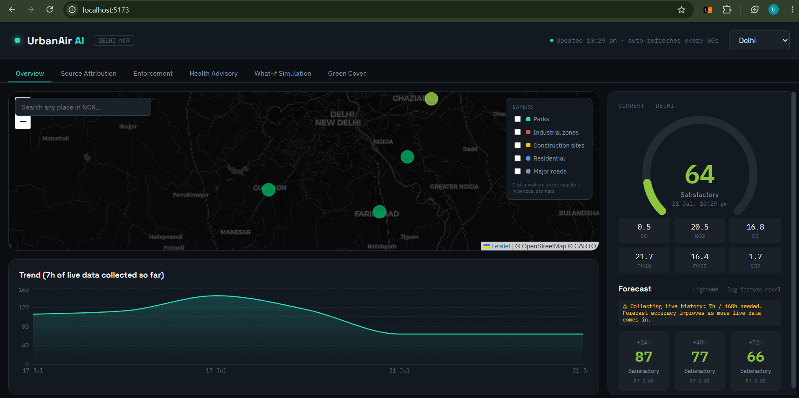
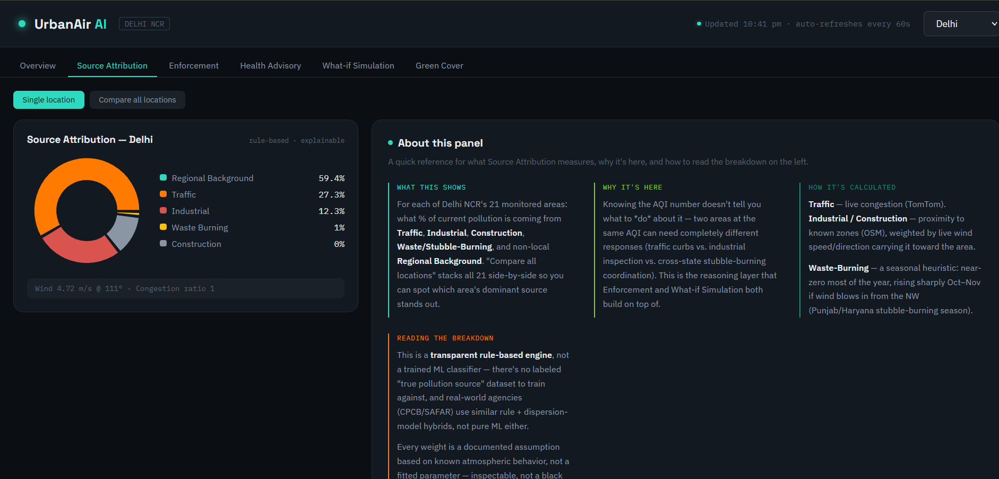
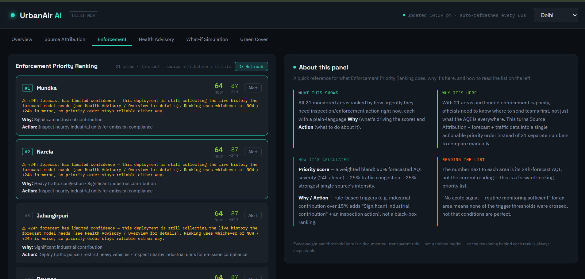
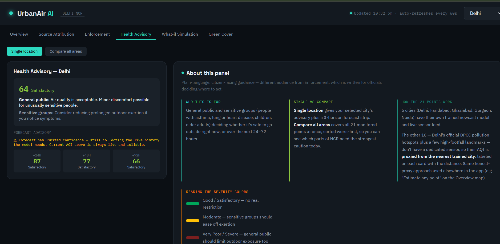
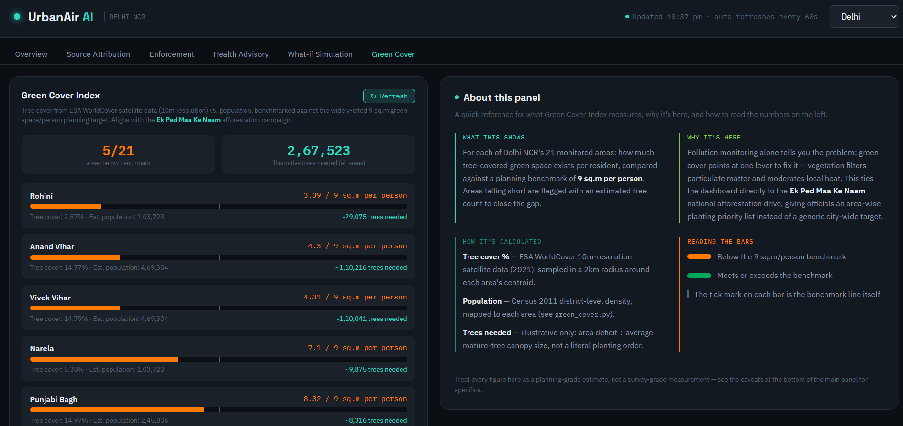
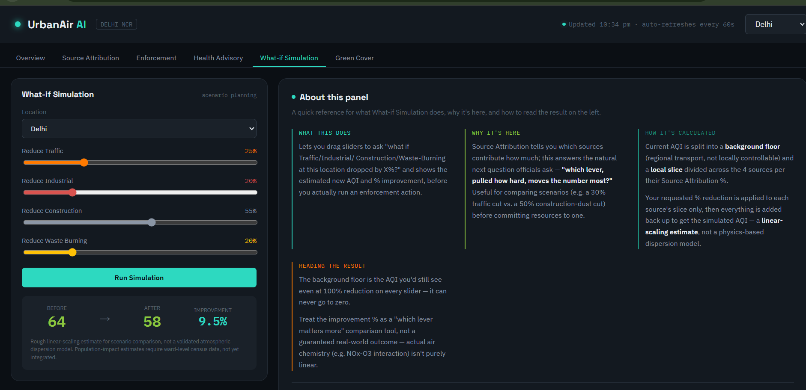

# UrbanAir AI


**A full-stack decision-support dashboard for Delhi NCR air quality** — live
monitoring, 24/48/72-hour forecasting, pollution source attribution,
enforcement prioritisation, public health advisories, and a green-cover
index, all computed from real data and served through a documented REST API.

> **Live application:** <https://urban-air-sigma.vercel.app/>
> **Backend API:** <https://urbanair-sr2m.onrender.com/api/health>

---

## Table of Contents

- [Overview](#overview)
- [Features](#features)
- [Architecture](#architecture)
- [Tech Stack](#tech-stack)
- [Monitored Areas](#monitored-areas)
- [Project Structure](#project-structure)
- [Getting Started](#getting-started)
- [Configuration](#configuration)
- [API Reference](#api-reference)
- [Data Pipeline & Freshness](#data-pipeline--freshness)
- [Persistence (Supabase, optional)](#persistence-supabase-optional)
- [Testing](#testing)
- [Deployment](#deployment)
- [Design Principles](#design-principles)
- [Scope, Assumptions & Limitations](#scope-assumptions--limitations)
- [Data Sources](#data-sources)
- [Screenshots](#screenshots)
- [License](#license)

---

## Overview

UrbanAir AI turns raw air-quality, weather, traffic and geospatial signals
into actionable output for the people who act on pollution — municipal
officials and the public. It covers the five pillars of the original
specification:

| # | Pillar | What it delivers |
|---|---|---|
| 1 | **Live AQI Dashboard** | Real-time AQI, pollutant breakdown and map for every monitored area |
| 2 | **Hyperlocal Forecast** | 24/48/72-hour AQI forecasts with category bands |
| 3 | **Source Attribution** | Explainable Traffic / Industrial / Construction / Waste-burning / Background split |
| 4 | **Enforcement Intelligence** | Ranked priority list with reasons and recommended actions |
| 5 | **Health Advisory** | CPCB-band guidance for the general public and sensitive groups |

Two stretch features are also implemented: a **Green Cover Index** and a
**What-if Simulation**.

The system is deliberately **transparent and explainable** — the
source-attribution and enforcement engines are documented rule engines
rather than opaque models, and every estimate carries its caveats in the
API response and the UI (see [Scope, Assumptions & Limitations](#scope-assumptions--limitations)).

---

## Features

- **Live monitoring** — AQI + PM2.5/PM10/NO₂/O₃/CO/SO₂ readings per area,
  with an instrument-style gauge and severity colouring based on official
  CPCB bands.
- **Forecasting** — one model per city predicting AQI at 24/48/72h horizons.
- **Source attribution** — combines live traffic congestion, wind
  direction/speed, proximity to industrial/construction zones and a
  seasonal stubble-burning heuristic into a five-way percentage split.
- **Enforcement ranking** — prioritises areas by forecast severity, source
  mix and traffic load, with plain-language reasons and recommended actions.
- **Health advisories** — current and forecast guidance for general and
  sensitive groups.
- **Alert delivery** — generate an Official Report or a Public Advisory and
  send it as an email, over the Resend HTTPS API (SMTP supported as an
  optional fallback).
- **Hyperlocal estimates** — search any NCR location or click anywhere on
  the map to get an estimate (AQI/forecast proxied from the nearest trained
  city; source attribution computed fresh for the exact point).
- **Green Cover Index** — tree-cover %, estimated population, green area
  per capita and an illustrative tree-count gap for each area, aligned with
  the *Ek Ped Maa Ke Naam* afforestation campaign.
- **What-if simulation** — sliders to model reducing each source by X% and
  see the resulting AQI improvement.

---

## Architecture

```
┌──────────────────┐    HTTPS / JSON    ┌────────────────────────┐
│    Frontend      │ ─────────────────▶ │   Backend (FastAPI)     │
│  React + Vite    │ ◀───────────────── │   ML + rule engines     │
│   (Vercel)       │                    │   (Render)              │
└──────────────────┘                    └───────────┬────────────┘
                                                      │ SQLAlchemy
                                                      ▼
                                          ┌────────────────────────┐
                                          │   Supabase Postgres     │
                                          │  (optional, recommended)│
                                          └───────────▲────────────┘
                                                      │ upsert (dedup)
                        ┌─────────────────────────────┴───────────────┐
                        │  Collectors (GitHub Actions cron or local)   │
                        │  OWM · TomTom · WAQI → CSV → sync_live_to_db  │
                        │  then persist_derived (forecasts, attribution)│
                        └──────────────────────────────────────────────┘
```

The application is fully functional in **CSV-only mode**; Supabase adds
persistence (historical AQI, persisted forecasts, attribution snapshots and
enforcement alerts). Every feature works with or without a database.

---

## Tech Stack

| Layer | Technology |
|---|---|
| Backend | Python, FastAPI, SQLAlchemy 2, Pydantic |
| ML / data | scikit-learn, LightGBM, CatBoost, pandas, NumPy, joblib, rasterio |
| Database | PostgreSQL (Supabase) — optional |
| Frontend | React 18, Vite 5, Leaflet / react-leaflet, Recharts |
| Email | Resend HTTPS API (SMTP fallback) |
| LLM (optional) | Groq for WAQI-vs-model arbitration |
| Automation | GitHub Actions (collectors + sync) |
| Hosting | Render (backend), Vercel (frontend), Supabase (database) |

---

## Monitored Areas

**21 areas** across Delhi NCR:

- **5 NCR cities** — Delhi, Faridabad, Ghaziabad, Gurgaon, Noida
- **13 designated pollution hotspots** — Anand Vihar, Ashok Vihar, Bawana,
  Dwarka, Jahangirpuri, Mundka, Narela, Okhla, Punjabi Bagh, R.K. Puram,
  Rohini, Vivek Vihar, Wazirpur
- **3 landmarks** — Chandni Chowk, Red Fort, Connaught Place

Hotspot locations follow the Dept. of Environment (GNCTD), 2018 list.
Coordinates are approximate locality centroids — cross-check against
CPCB's official CAAQMS station list for monitoring-grade precision.

---

## Project Structure

```
urbanair_full_stack/
├── aqi_model/              # Data collection + model training
│   ├── run_all.py          # Runs all collectors on a loop
│   ├── *_collector.py       # OWM air, TomTom traffic, OWM weather, WAQI AQI
│   ├── train_model.py       # AQI nowcast model
│   ├── train_forecast_model.py  # 24/48/72h forecast models
│   └── *.geojson / *.csv    # Static geospatial + processed datasets
├── urbanair_backend/       # FastAPI service
│   ├── app/                # main.py, alert_generator, notifications, groq_arbiter
│   ├── db/                 # SQLAlchemy models, repository, service
│   ├── scripts/            # schema import, live sync, derived persistence, self-tests
│   ├── models/             # nowcast model artifacts
│   ├── models_forecast/    # forecast model artifacts
│   └── tests/              # unittest suite
├── urbanair_frontend/      # React + Vite dashboard
│   └── src/                # App, components, api client
├── database/schema.sql     # Idempotent Supabase schema
├── .github/workflows/      # collect.yml — scheduled data collection
├── DEPLOYMENT.md           # Full deployment guide
├── FREE_DEMO_DATA.md       # Free data-freshness setup
├── render.yaml             # Render blueprint
└── LICENSE
```

---

## Getting Started

### Prerequisites

- **Python 3.11+** (3.11 recommended for hosted builds)
- **Node.js 18+**
- API keys for the collectors are included in the bundled `.env` files for
  offline/demo use — nothing to sign up for to run locally.

You will run **three processes**: the collectors, the backend, and the
frontend. Start them in that order.

### 1. Collectors — `aqi_model/`

```bash
cd aqi_model
python -m venv venv
source venv/bin/activate        # Windows: venv\Scripts\activate
pip install -r requirements.txt
python run_all.py
```

`run_all.py` starts all four collectors (air pollution, traffic, weather,
WAQI ground AQI) on a loop and mirrors the CSVs it produces into
`urbanair_backend/` every five minutes. Leave it running. Wait a minute or
two after first start so at least one reading is logged — the backend
returns `503` for a city until its first live reading arrives.

### 2. Backend — `urbanair_backend/`

```bash
cd urbanair_backend
python -m venv venv
source venv/bin/activate        # Windows: venv\Scripts\activate
pip install -r requirements.txt
python -m uvicorn app.main:app --reload --port 8000
```

Verify: <http://127.0.0.1:8000/api/health>

### 3. Frontend — `urbanair_frontend/`

```bash
cd urbanair_frontend
npm install
npm run dev
```

Open <http://localhost:5173>. The Vite dev server proxies `/api/*` to the
FastAPI backend on port 8000 (see `vite.config.js`).

### Day-to-day

Only the collectors (`run_all.py`) need to stay running for fresh data.
The backend and frontend can be started and stopped independently.

---

## Configuration

All configuration is via environment variables. Copy the relevant
`.env.example` and fill in your values — never commit real `.env` files.

**Backend (`urbanair_backend/.env`)**

| Variable | Purpose |
|---|---|
| `DATABASE_URL` / `SUPABASE_DB_URL` | Supabase pooler URI (`sslmode=require`). Optional. |
| `CORS_ORIGINS`, `FRONTEND_URL` | Allowed browser origin(s) in production. |
| `RESEND_API_KEY`, `RESEND_FROM_EMAIL` | Email alerts over the Resend HTTPS API (recommended). |
| `SMTP_EMAIL`, `SMTP_APP_PASSWORD`, `SMTP_HOST`, `SMTP_PORT` | Optional SMTP fallback. |
| `GROQ_API_KEY` | Optional WAQI-vs-model arbitration in `/api/current`. |
| `DB_ECHO`, pool knobs | Tuning / diagnostics. |

**Frontend (`urbanair_frontend/.env`)**

| Variable | Purpose |
|---|---|
| `VITE_API_BASE_URL` | Backend base URL including `/api` (required in production). |
| `VITE_DEV_PROXY_TARGET` | Backend target for the dev proxy. |
| `VITE_MAP_TILE_URL` | Optional custom map tile URL. |

**Collectors (`aqi_model/.env`)**

`TOMTOM_API_KEY`, `OWM_API_KEY`, `WAQI_API_TOKEN`.

> **Email note:** managed hosts such as Render block outbound SMTP ports
> (25/465/587), which causes `[Errno 101] Network is unreachable`. Use the
> **Resend** variables above in production; SMTP is a fallback only.
> A successful send means the provider *accepted* the message — it does not
> guarantee inbox delivery.

---

## API Reference

Base URL: `https://urbanair-sr2m.onrender.com` (or `http://localhost:8000`).

**Health**

| Method | Endpoint | Purpose |
|---|---|---|
| GET | `/api/health` | Liveness + whether a database is configured |
| GET | `/api/db/health` | Real database connectivity check |

**Air quality**

| Method | Endpoint | Purpose |
|---|---|---|
| GET | `/api/cities` | Monitored cities + coordinates |
| GET | `/api/current/{city}` | Latest AQI + pollutant readings |
| POST | `/api/nowcast` | AQI from manually entered pollutant readings |
| GET | `/api/forecast/{city}` | 24/48/72h forecast |
| GET | `/api/historical/{city}?hours=` | Time series for the trend chart |
| GET | `/api/aqi/history/{city}` | Paginated persisted AQI history |
| GET | `/api/forecasts/{city}` | Latest persisted forecasts |

**Geospatial**

| Method | Endpoint | Purpose |
|---|---|---|
| GET | `/api/geojson/{layer}` | Layer geometry (`parks` \| `residential` \| `industrial` \| `construction` \| `roads`) |
| GET | `/api/search-location?query=` | Geocoding (Nominatim), NCR-bounded |
| GET | `/api/estimate?lat=&lon=` | Hyperlocal estimate for any point |

**Attribution & enforcement**

| Method | Endpoint | Purpose |
|---|---|---|
| GET | `/api/source-attribution` | Source split for all monitored areas |
| GET | `/api/source-attribution/{point}` | Source split for one area |
| GET | `/api/enforcement` | Ranked priority list with reasons + actions |
| GET | `/api/alerts` | Persisted enforcement alerts |

**Alerts & advisories**

| Method | Endpoint | Purpose |
|---|---|---|
| GET | `/api/alerts/officials/{point}` | Official report text |
| GET | `/api/alerts/public/{point}` | Public advisory text |
| POST | `/api/alerts/send` | Send a report/advisory by email |
| GET | `/api/alerts/status` | Whether an email provider is configured |
| GET | `/api/health-advisory/{city}` | Current + forecast health advisory |
| GET | `/api/health-advisory` | Health advisory for all areas |

**Green cover & simulation**

| Method | Endpoint | Purpose |
|---|---|---|
| GET | `/api/green-cover` | Green Cover Index for all areas |
| GET | `/api/green-cover/{point}` | Green Cover Index for one area |
| POST | `/api/whatif` | Simulate reducing sources by X% |

Interactive OpenAPI docs are available at `/docs`.

---

## Data Pipeline & Freshness

The backend **reads** data; it does not collect it. Collection runs
separately.

- **Local:** `python run_all.py` (from `aqi_model/`) loops the collectors
  and mirrors the latest CSVs into `urbanair_backend/` every five minutes.
- **Production (free):** the `.github/workflows/collect.yml` GitHub Actions
  job runs the collectors every 30 minutes and syncs into Supabase via
  `python -m scripts.sync_live_to_db`, then computes derived data
  (forecasts, source attribution) with `python -m scripts.persist_derived`.
  See [FREE_DEMO_DATA.md](FREE_DEMO_DATA.md).
- **Production (paid):** an always-on Render Background Worker running
  `python run_all.py` (commented out in `render.yaml`).

The backend re-reads its inputs on every request, so no restart is needed
after new data lands.

---

## Persistence (Supabase, optional)

Adding Supabase enables historical AQI, persisted forecasts,
source-attribution snapshots and enforcement alerts. Nothing else changes.

1. Apply [`database/schema.sql`](database/schema.sql) in the Supabase SQL
   Editor (idempotent, never drops data).
2. Import history (optional):
   `python -m scripts.import_historical` — duplicate-safe, non-destructive.
3. Keep live data flowing with
   `python -m scripts.sync_live_to_db` (idempotent).

Full instructions, including backup and dry-run guidance, are in
[DEPLOYMENT.md](DEPLOYMENT.md).

---

## Testing

**Backend** (from `urbanair_backend/`):

```bash
python -m unittest discover -s tests -t .
```

The suite covers the API, database layer and pooling, CSV fallback,
derived-data persistence, schema import/sync, alert/email handling
(provider mocked) and batching regressions.

**Frontend** (from `urbanair_frontend/`):

```bash
npm test        # node --test
npm run build   # production build
```

---

## Deployment

The stack deploys to **Render** (backend), **Vercel** (frontend) and
**Supabase** (database). Step-by-step instructions — including environment
variables, the Supabase schema, the Resend email setup and troubleshooting —
are in **[DEPLOYMENT.md](DEPLOYMENT.md)**.

A `render.yaml` blueprint provisions the backend web service; the frontend
is deployed separately on Vercel with root directory `urbanair_frontend`.

---

## Design Principles

UrbanAir AI is built as a **control-room interface**, not a marketing page —
its audience is officials monitoring live conditions. A dark base lets
severity colours read clearly, monospace type (IBM Plex Mono) is used for
all numeric readouts to feel measured, and Space Grotesk for headings. The
AQI severity palette follows official CPCB bands and is kept distinct from
the app's own accent colour, so a real pollution reading is never confused
with branding.

Explainability is a feature: the rule engines expose *why* they reached a
conclusion, which is a stronger pitch for a government-facing tool than an
opaque model.

---

## Scope, Assumptions & Limitations

This is a **prototype / decision-support tool**, and it is honest about its
bounds:

- **Source attribution and enforcement are transparent rule engines**, not
  trained classifiers. There is no labelled ground-truth dataset for
  "true pollution source" (real-world source apportionment uses
  dispersion-model hybrids too). Every weight is a documented assumption
  based on known atmospheric behaviour — not a fitted parameter.
- **What-if simulation** is a linear-scaling scenario estimate, not a
  validated dispersion model. It is labelled as such in the API response
  and the UI.
- **Green Cover** population figures are district-density estimates, not
  exact ward census counts, and the "trees needed" number is illustrative.
  The 9 m²/person benchmark is a planning reference, not a regulatory
  mandate.
- **Email alerts are demo-grade**, not a government notification system. A
  real deployment would use the official channel (SMS gateway, internal
  alert queue, WhatsApp Business API, etc.). A successful send means the
  provider accepted the message, not that it reached an inbox.
- **Hotspot coordinates** are approximate locality centroids.

---

## Data Sources

- **OpenWeatherMap** — air pollution and weather
- **TomTom** — traffic congestion
- **WAQI / CPCB** — ground-truth AQI
- **ESA WorldCover (2021)** via Google Earth Engine — tree cover
- **Census 2011** — district population density
- **OpenStreetMap** — geospatial layers
- Historical dataset: `processed_aqi_data.csv` (5 cities, hourly, 2019–2024)

---

## Screenshots

### Dashboard


### Source Attribution


### Enforcement Intelligence


### Health Advisory


### Green Cover Index


### What-if Simulation


---

## License

Released under the [MIT License](LICENSE).

